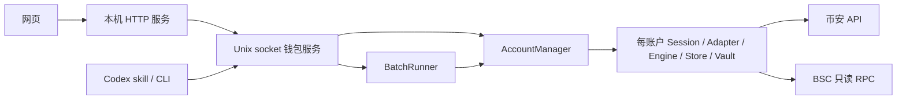

# 架构与边界

## 入口

网页监听 127.0.0.1；钱包后端监听权限为 0600 的 Unix socket。网页不直接打开生产数据库，而是经同一服务读取快照并维护账户。

网页前端不依赖远端脚本或构建服务。HTTP API 校验 Host、Origin、Sec-Fetch-Site 和写请求 CSRF，拒绝任意钱包方法转发。快照只输出可展示的交易摘要，不包含 requestId、签名、会话 cookie 或预览授权。

## 账户

原账户使用 `legacy-default` ID、`default` 别名，保留兼容的数据库、Vault 和官方会话位置。新账户各有独立目录、随机加密密钥、会话、数据库和队列；钥匙串使用安装 ID 与账户 ID 区分条目。

账户首次登录后固定绑定钱包，拒绝重复钱包或后续地址变化。配对任务、缓存、预览和恢复操作均归属于所选账户。名称、备注和归档属于展示元数据，不改变账户标识、钱包或设备信息。

每账户保存固定的客户端设备档案，登录、查询、预览、执行与恢复使用同一份配置。不同账户的 MAC、主机名与系统版本配置不同。这些是客户端上报字段，不会修改实际网卡或操作系统，也不代表对币安后台设备归类的保证。

## 交易与恢复

操作经历准备、预览、授权、保存提交意图、提交、对账和业务结果核验。预览绑定钱包、会话、账户、链与载荷；相同幂等键重试不产生新的执行。

同账户串行，不同账户有限并发。网络结果不明时保留原操作并对账，不自动生成另一笔交易。已广播或待 App 确认不等于完成；成功需回执达到确认数，并满足配置的业务结果检查。receipt-only 只表示交易执行成功。

批次保存固定的账户列表、逐账户参数和限额，通过同一 planToken 授权执行；子操作不能绕过批次直接确认。服务重启会暂停未完成批次，已提交项继续对账。取消只阻止未提交任务。

## 记录与支持范围

项目视图遍历服务已保存的全部操作，合并已识别项目的不同合约。未提交预览不计为成功参与；失败尝试单独统计。历史领取数量不作为实时资产余额。

默认支持 BSC；聚合兑换使用币安接口，显式 V2 交易使用已审阅路由。通用项目认证、同一币安登录内任意选择子钱包、多链与设备换绑尚未实现。平台风控、额度和 App 确认仍由币安控制。
